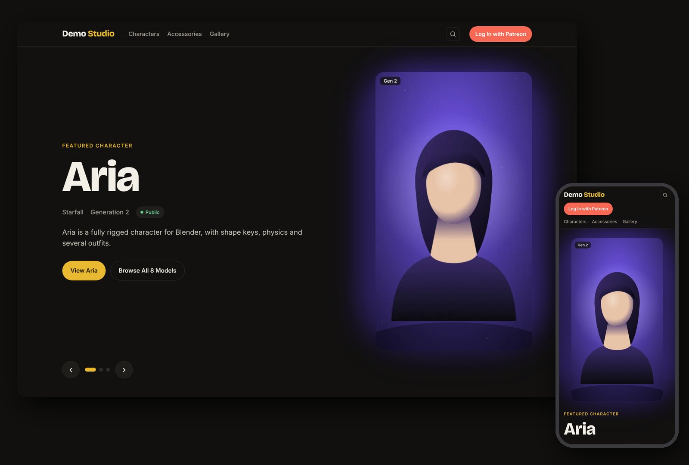
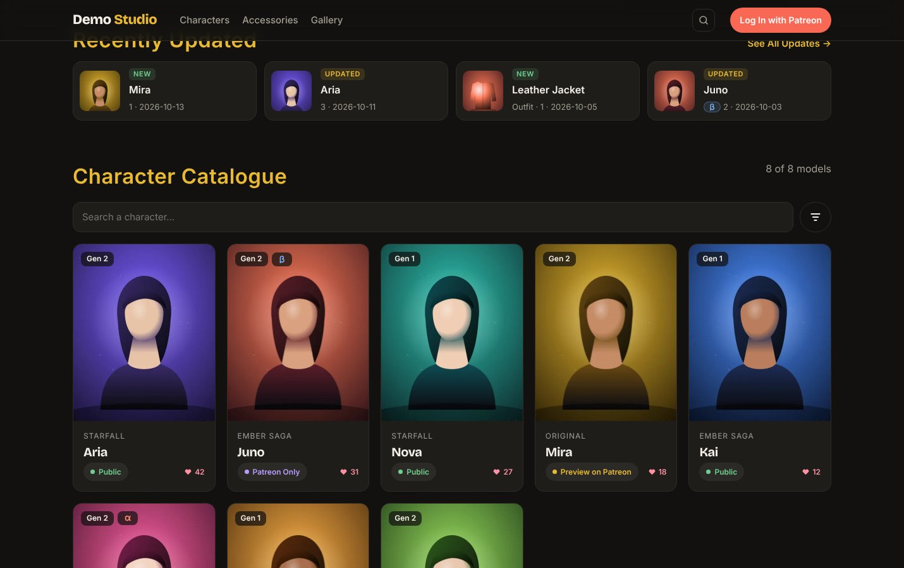
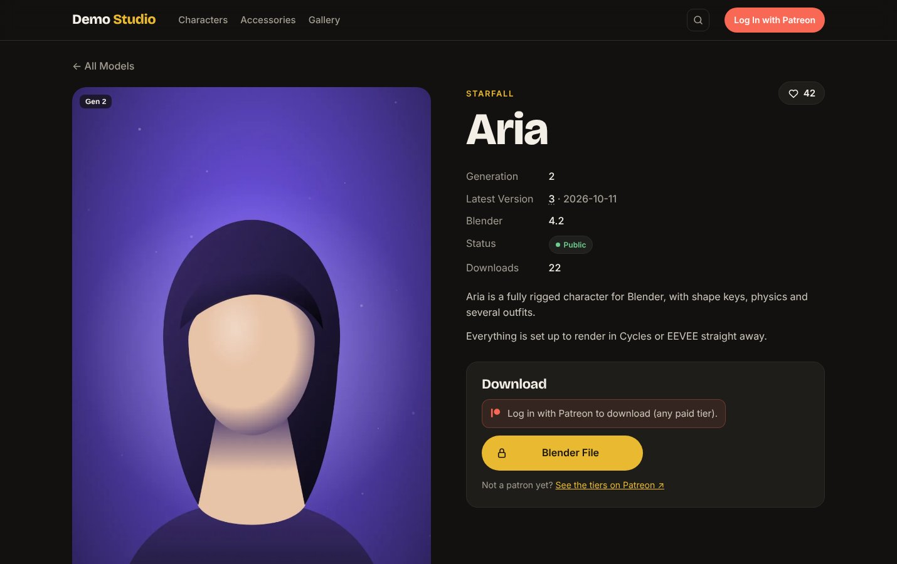
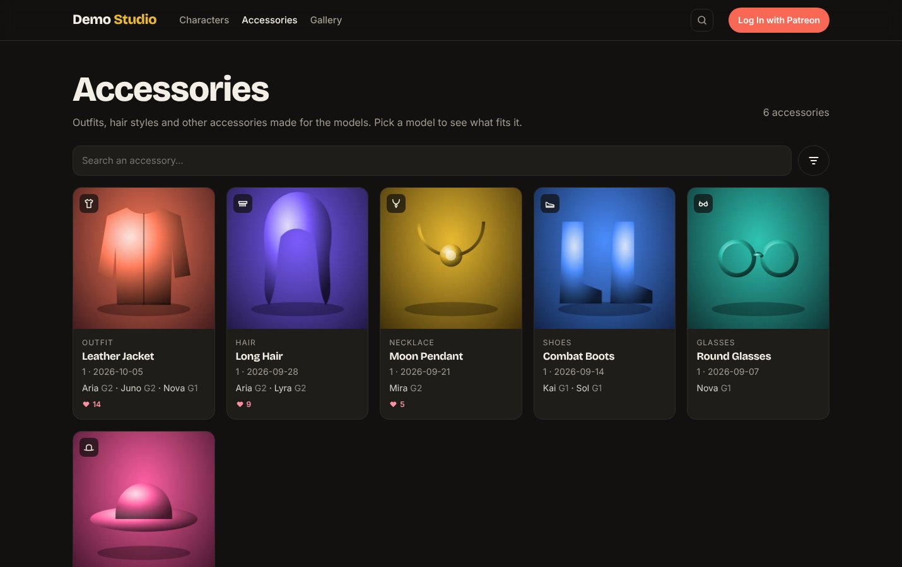
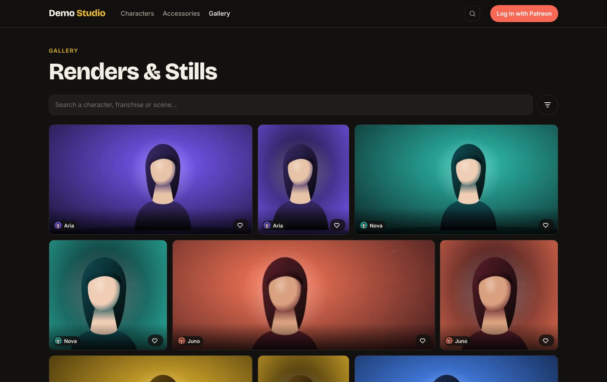
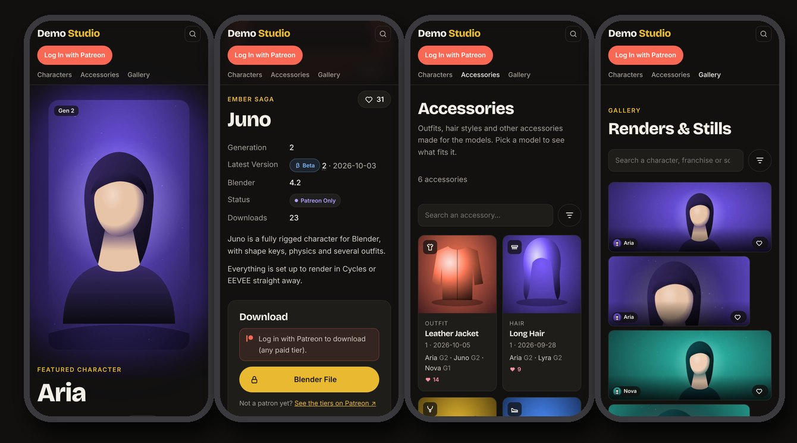
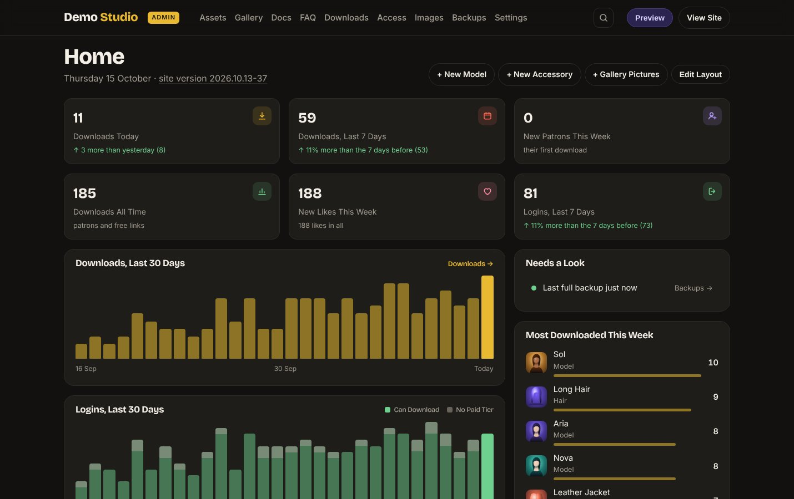
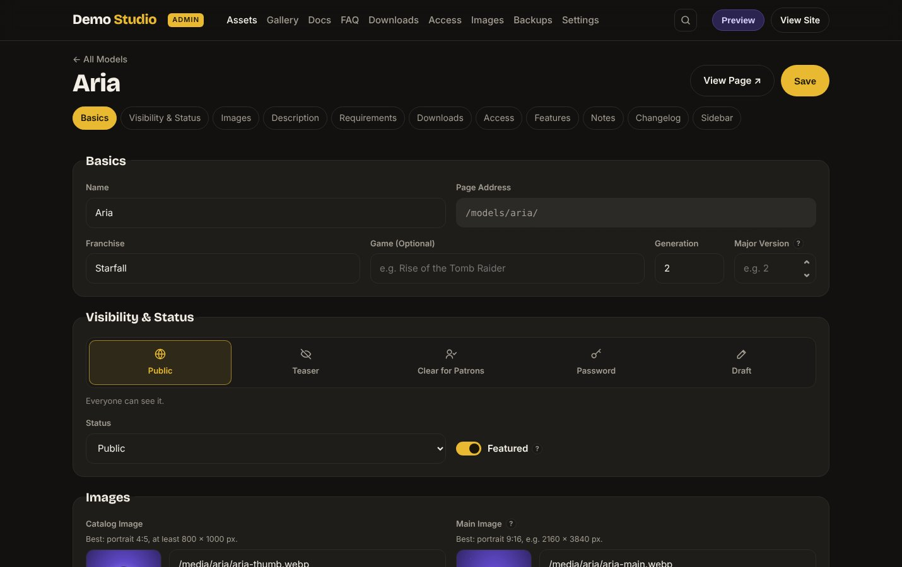

# MustardWebsite

**A self-hosted website for 3D creators who share their work on Patreon.**
Show your characters and accessories in a clean catalogue, keep a changelog for every release, and let your patrons
download the files after logging in with Patreon. You run everything from a built-in admin panel: no coding needed
once it's installed.



<sub>All screenshots use a demo site with made-up characters and patrons.</sub>

- **Simple to host**: plain PHP 8.1+, no database, no framework, no build step. It runs on ordinary shared hosting
  (any Apache or LiteSpeed host that reads `.htaccess`).
- **Patreon built in**: patrons log in with Patreon and paid tiers unlock the downloads. The real file addresses never
  appear in the page.
- **Private by design**: no third-party requests from the pages, only strictly necessary cookies, and a ready-made
  privacy policy page.
- **Free software** under the GPL-3.0-or-later.

**Contents:** [Features](#features) · [Screenshots](#screenshots) · [Installing](#installing-on-a-host) ·
[Updating](#updating) · [Testing on your computer](#testing-on-your-computer) · [Privacy](#privacy-gdpr) ·
[Folders](#folders) · [License](#license)

## Features

### For your visitors

- **Catalogue** with a featured slideshow, "Recently Updated", search and filters (franchise, status, generation),
  and a "What's New" page with every release.
- **Model pages** with a picture gallery and full-screen viewer, facts, features, notes, a changelog with alpha and
  beta versions, required add-ons, likes and download counts. Optional **3D preview** of a `.glb` file, right in the page.
- **Accessories** (outfits, hair, necklaces…) linked to the models they fit.
- **Gallery** of renders and stills, with likes and optional full-size downloads.
- **Docs and FAQ** written in a simple text format (headings, lists, boxes, tables, tabs, code, pictures).
- **Bug reports** (optional): patrons report problems, follow them, and see when they are fixed.
- Works on phones, has a dark theme, and asks for an 18+ confirmation before entering.

### For your patrons

- **Log in with Patreon**: any paid tier unlocks the downloads, or you add extra rules per item
  (minimum tier, months as a patron, total support).
- **Unlock limits** if you want them, like "1 new model per week", plus a waiting time before each download.
- **Release dates**: early access for patrons first, then free for everyone on a later date.
- **My Account** page with their membership, unlocks left, every item they downloaded and the updates they're missing.

### For you, the creator

- **Admin panel** with an editor for every model, accessory, gallery picture, doc page and FAQ question.
- **Image library**: uploads become WebP in several sizes automatically, with cropping and rotating.
- **Statistics**: a dashboard with downloads, logins and likes, plus the full download log.
- **Download links you can trust**: a link checker for MEGA, transfer.it and other websites, and signed
  short-lived links for files stored on MEGA S4.
- **Discord announcements** of new versions and gallery pictures through a webhook.
- **Your own look**: site name, tagline, logo, accent colour, social links and homepage texts.
- **Safety nets**: full backups and restore, maintenance mode, a site notice, and "Preview" to see the site as any kind of patron.
- **One-click updates** from the admin, with the previous code saved first.

## Screenshots

| Character catalogue | Model page |
|---|---|
|  |  |
| **Accessories** | **Gallery** |
|  |  |

**On a phone**



**Admin panel**

| Home dashboard | Model editor |
|---|---|
|  |  |

## Installing on a host

### What you need

- PHP 8.1 or newer with the `gd`, `curl`, `zip` and `mbstring` extensions (usually on by default).
- HTTPS, and `.htaccess` support (Apache or LiteSpeed).
- A Patreon creator account.

### Steps

1. **Upload** the contents of `public_html/` into your site folder (often called `public_html`), and the `private/`
   folder **next to** it, for example:
   ```
   domains/example.com/public_html   ← the site
   domains/example.com/private       ← settings, data, logs, backups
   ```
   (`private/` also works one level higher, or inside the site folder, where its own `.htaccess` blocks web access.)
2. **Open your site.** It shows **Set Up Your Site** and guides you through four steps:
   1. *Your server*: open `private/setup-code.txt` with your host's file manager and paste the code. This proves the
      site is yours, so nobody else can take over a fresh install.
   2. *Patreon*: create a client at <https://www.patreon.com/portal/registration/register-clients>, enter the redirect
      address the page shows (`https://<your site>/auth/callback.php`), then paste its **Client ID** and **Client Secret**.
   3. *Log in* with your creator account. It becomes the owner (the admin) and your campaign is read from it.
   4. *The basics*: site name, tagline, colour, who runs the site (for the privacy page) and a support email.

The page creates `private/config.php` by itself. Afterwards everything can be changed in **Admin → Settings**.

> [!NOTE]
> The Patreon keys are saved only through the setup page and **Admin → Settings → Patreon** (in `private/patreon.php`),
> never in `config.php`. To find your Patreon user id and campaign id by hand, set `'debug' => true` in `config.php`
> and log in: the page shows both. Set it back to `false` afterwards.

### First steps in the admin

1. **Settings → Site Identity**: name, tagline, logo and colour. **Social Links**: the footer buttons (Patreon, Discord…).
2. **Models** and **Accessories**: add your items, their pictures and download links. Each link is *Patrons Only* or *Public*.
3. **Access**: the waiting time before downloads, unlock limits and exceptions (for testers, for example).
4. **Docs** and **FAQ**: they show up in the menu as soon as they have content.
5. **Settings → Homepage Section**: the "how to get the downloads" boxes, if you want them.

## Updating

New versions are installed from the admin, without FTP: **Admin → Settings → Update** lists the versions newer than
yours with what changed, and installs one when you press **Install**. Nothing installs by itself.

- **Stable** (the default) comes from the public repository
  [Mustard2/MustardWebsite](https://github.com/Mustard2/MustardWebsite). No key needed.
- **Development** gets every change as soon as it is merged. It needs a read-only GitHub key for the development
  repository, pasted in the Update Channel box.

The updater only replaces code. It never touches `media/` (your images) or `private/` (data, settings, logs), it saves
the current code first so you can roll back from **Admin → Backups**, and it never deletes files. **Admin → Backups**
also makes full backups (content, counters, log, and optionally the images) that you can download and restore.

<details>
<summary>How releases are made (for maintainers)</summary>

Two GitHub Actions workflows in the development repository build the versions:

- **Development release** runs on every merge to `main` that changes `public_html/`. It builds the update zip
  (`make_update.py`, version `YYYY.MM.DD-N`) and publishes it as a release, with the `## Changelog` bullets of the
  merged pull requests as its notes.
- **Publish to Stable** runs only when started by hand (Actions → Publish to Stable → Run workflow, optionally with a
  version). It copies that exact zip to the public repository with the code of that version, a `CHANGELOG.md`, and one
  list of everything that changed since the last Stable version. It needs the secret `STABLE_REPO_TOKEN`: a
  fine-grained token with *Contents: Read and write* on the public repository only.

A zip can also be installed by hand with **Update from File** on the same page, for example one built on your computer:

```bash
python3 make_update.py      # checks every PHP file, writes dist/site-update-<version>.zip
```

</details>

## Testing on your computer

You need PHP 8.1+ with the extensions above (check with `php -v` and `php -m`). PHP's built-in server is enough:
no web server or database.

```bash
git clone <this repository> site && cd site
php -S localhost:8000 -t public_html local-test.php
```

Then open <http://localhost:8000>. A fresh copy opens on the **Set Up Your Site** page; the first request creates
`private/config.php` from the example. `local-test.php` does what `.htaccess` does on the server (pretty addresses,
blocked folders) and refuses to run anywhere else. Stop it with Ctrl+C.

The Patreon login can't work on your computer, so there is a **local login** instead. It also answers the 18+
question for you:

| Open this address | You are |
|---|---|
| <http://localhost:8000/__local/login?as=owner> | the owner: the admin opens (on a fresh copy you become the owner and the setup's last step opens) |
| <http://localhost:8000/__local/login?as=patron> | a paying patron (6 months, 30 in total support) |
| <http://localhost:8000/__local/login?as=free> | logged in without a paid tier (downloads refused) |
| <http://localhost:8000/__local/login?as=logout> | a visitor again |

As the owner you can try every other patron situation with **Preview** in the admin header (tiers, months, downloads,
updates). Everything else works locally too: adding models, uploading and cropping images, docs, FAQ, settings,
backups and the download pages. Your test data stays in `private/data/` and `public_html/media/`, which are never part
of updates.

**Before shipping a change**, check that:

- `python3 make_update.py` passes (it runs `php -l` on every PHP file and stops on an error);
- pages 390 px wide (a phone) don't scroll sideways;
- the page source has no external addresses (fonts, scripts) and no patron download address;
- the PHP server's output in the terminal shows no warnings or errors while you click around.

## Privacy (GDPR)

The pages make no requests to other websites: fonts are self-hosted and there are no analytics or embeds. Visitors
only get strictly necessary cookies, so no consent banner is needed.

`/privacy/` describes the Patreon login, the cookies, the download log and the hosting. Fill in who runs the site in
**Admin → Settings → Privacy → Legal & Contact** (the page shows a placeholder until you do). Download log lines older than
`log_retention_days` in `config.php` (365 by default) are deleted automatically. When someone asks for their data, find them
in **Admin → Settings → Privacy → Personal Data** (Patreon user ID or name): it downloads everything stored about them as
a readable file (or JSON), and can delete it all. If you add a service, a cookie or
any other processing of personal data, update `privacy.php` too.

## Folders

```
public_html/          the website (upload its contents to your site folder)
  index.php …         public pages
  admin/              the admin panel (owner only)
  auth/               Patreon login, download gate, likes
  app/                shared code (never reachable from the web)
  assets/             styles, scripts, fonts
  media/              uploaded images (created by the admin panel)
private/              settings, data, logs and backups: put it NEXT TO the site folder
  config.example.php  the template for config.php (the setup page copies it)
  data/               models, accessories, settings, FAQ, docs… as JSON (written by the admin)
docs/screenshots/     the pictures of this README
local-test.php        router for testing on your computer (never upload it)
make_update.py        builds an update zip for the admin's Update page
```

## License

Copyright (C) 2026 Mustard3D

This program is free software: you can redistribute it and/or modify it under the terms of the GNU General Public
License as published by the Free Software Foundation, either version 3 of the License, or (at your option) any later
version (**GPL-3.0-or-later**).

This program is distributed in the hope that it will be useful, but WITHOUT ANY WARRANTY; without even the implied
warranty of MERCHANTABILITY or FITNESS FOR A PARTICULAR PURPOSE. See the GNU General Public License for more details.

You should have received a copy of the GNU General Public License along with this program (the `LICENSE` file).
If not, see <https://www.gnu.org/licenses/>.

The fonts in `public_html/assets/fonts/` (Inter, Bricolage Grotesque) are under the SIL Open Font License; the social
network icons come from Simple Icons (CC0). The 3D viewer is Google's `<model-viewer>` (Apache 2.0, with three.js and Lit
inside; see `public_html/assets/vendor/LICENSE-model-viewer.txt`).
